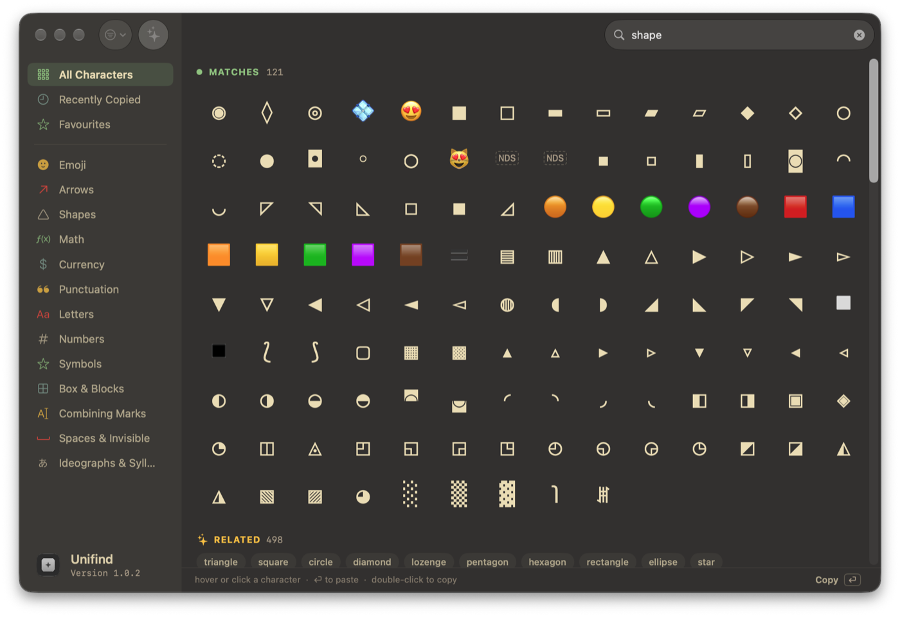
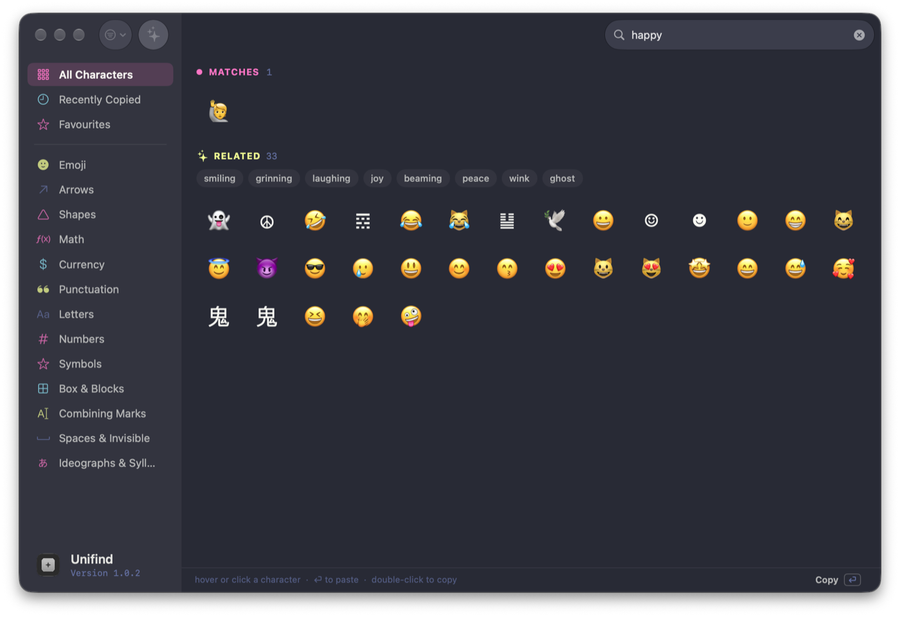
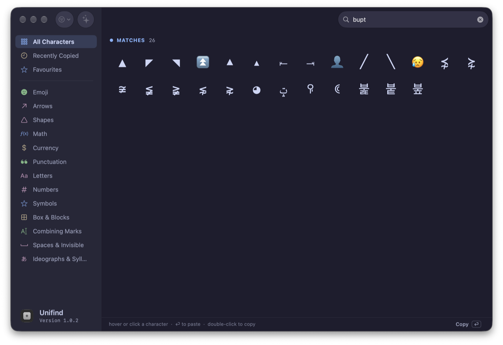
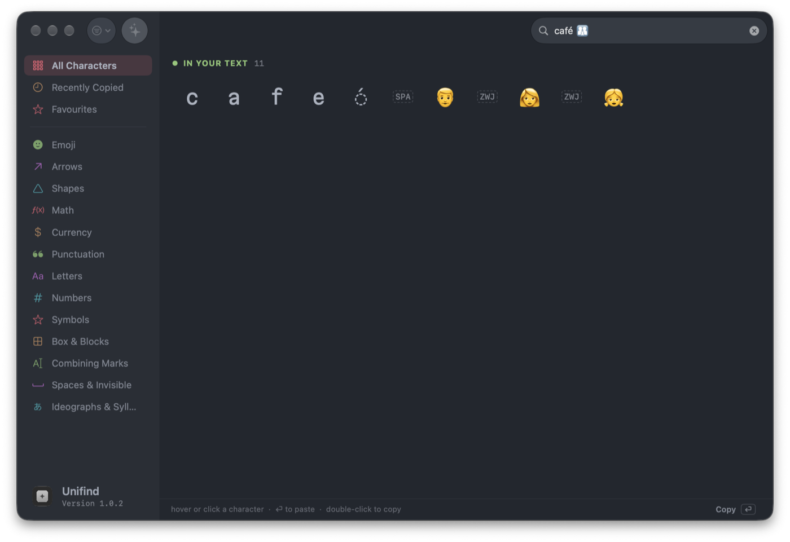
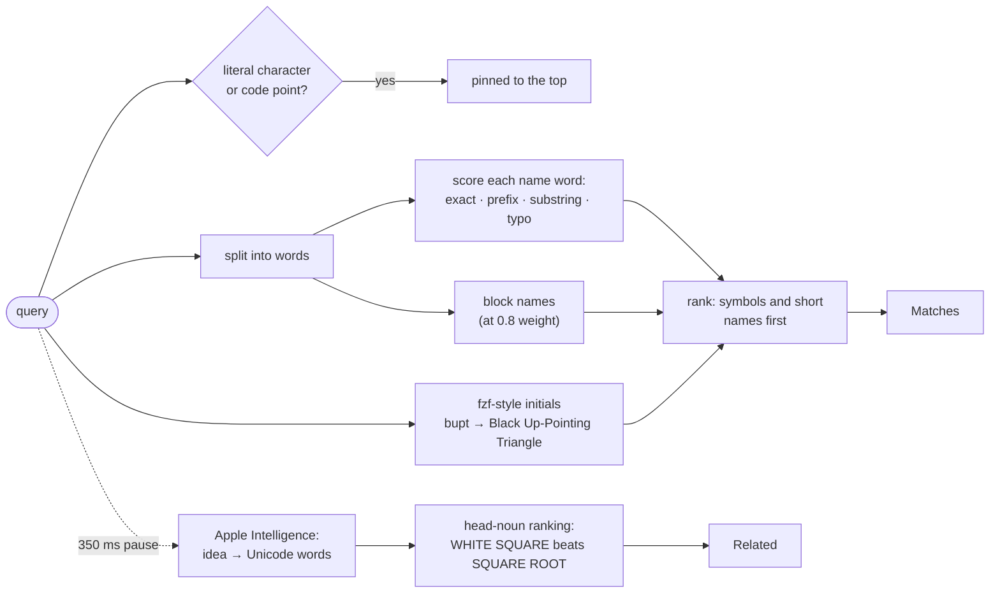

<div align="center">


# Unifind

**Find any Unicode character by name, shape or idea.**

A native macOS Unicode character finder with fuzzy, fzf-style search over all ~160,000 named
characters, plus on-device Apple Intelligence that understands what you mean.

[](#install)
[](#install)
[](https://zmscode.github.io/Unifind/)

```sh
brew install --cask zmscode/unifind/unifind
```



</div>

## Highlights

- **Search the way you think.** Type a name (`snowman`), a typo (`triangel`), a prefix
  (`lozen`), initials (`bupt` → BLACK UP-POINTING TRIANGLE), the character itself (`→`) or a
  code point (`U+2603`, `0x2603`, `2603`).
- **Smart Search.** Loose ideas like `shape`, `happy` or `weather` are expanded on device by
  Apple Intelligence into the words Unicode actually uses, shown as a **Related** section with
  clickable term chips.
- **Paste into the app you were using.** Hover or select a character and press **⏎**:
  Unifind switches back and pastes it, or copies when there's no text field to paste into.
- **Inspect any text.** Paste something like `café 👨‍👩‍👧` to see every character in it,
  including the invisible ones: combining accents, zero-width joiners, variation selectors.
- **Browse by category.** Emoji, Arrows, Shapes, Math, Currency, Box & Blocks and more, plus
  your own **Recently Copied** and **Favourites**.
- **Looks the way you like.** 23 editor themes ported from Lines, and any installed font for the
  glyphs. Hover a character to see it in every weight its font has.
- **Only what you can see.** Characters that no installed font can draw are hidden, so you never
  get "?" boxes (Filter › Show Characters Without a Font brings them back).

## A tour

<table>
<tr>
<td width="50%"></td>
<td width="50%"></td>
</tr>
<tr>
<td><b>Smart Search.</b> <code>happy</code> barely appears in Unicode names, so Apple Intelligence
suggests <i>smiling, grinning, laughing, joy…</i>; click a chip to search for that word.
(Dracula theme)</td>
<td><b>fzf-style initials.</b> <code>bupt</code> finds BLACK UP-POINTING TRIANGLE: every run of
letters has to start a word, and fewer runs rank higher. (Catppuccin Mocha)</td>
</tr>
<tr>
<td></td>
<td>

**In your text.** Paste text with anything beyond plain ASCII and Unifind lists each character
in order. Here `café 👨‍👩‍👧` turns out to be an `e` plus a combining acute accent, and a family
emoji built from three people joined by ZWJs. (One Dark Pro)

**The detail bar** along the bottom shows the selected character's code point, Unicode block and
category, with one-click copies of `U+2603`, `&#x2603;`, `\u{2603}` and the name, plus ☆ to
add it to Favourites.

</td>
</tr>
</table>

## How search works

Unifind builds an index of every named scalar when it launches. The names come from Swift's
`Unicode.Scalar.Properties`, the block names from the ICU that ships with macOS, and CoreText
reports which characters your fonts can draw. A query then runs through this pipeline:



- **Every word must match** some word of the name, or of the character's Unicode block (so
  `shape` finds everything in Geometric Shapes). A word scores 1 for an exact match, 0.7–0.9 for a
  prefix, 0.4 for a substring, and 0.3–0.5 when it's within one or two typos.
- **Quality bonuses** favour symbols over letters and ideographs that merely mention a word,
  short names over long ones, and the Basic Multilingual Plane and emoji over obscure planes.
- **Related** results come from asking the on-device model for words that appear in real Unicode
  names. Words that would swamp the results (*face, sign, black…*) are dropped, and characters
  whose name is *about* the word rank first: WHITE SQUARE is a square, SQUARE ROOT isn't. When
  Apple Intelligence is off or unavailable, macOS's word embeddings suggest neighbours instead.

## Keyboard and mouse

| Action | How |
| --- | --- |
| Paste into the last app (or copy) | **⏎** on the hovered, selected or top character |
| Copy a character | double-click it, or click the big glyph in the detail bar |
| Select | click |
| Add to or remove from Favourites | **⌘D**, ☆ in the detail bar, or right-click |
| Copy name or code point | right-click, or the pills in the detail bar |
| Inspect what's on the clipboard | **⇧⌘V** |
| Drag a character into another app | drag its tile |
| Settings (theme, glyph font, pasting) | **⌘,** |

Pasting into other apps needs Accessibility access (Settings › General walks you through it). If
you turn pasting off, ⏎ just copies.

You can also open Unifind with a search already typed:

```sh
open -a Unifind --args -query arrow
```

## Themes

Settings › Appearance has 23 themes from the Lines editor, previewed live:

**Gruvbox** (Dark Soft is the default) · **0x96f** · **Catppuccin** (Latte, Frappé, Macchiato,
Mocha) · **One Dark Pro** · **Dracula** and Alucard · **JetBrains** Dark and Light · **Monokai** ·
**VS Code Dark Modern** · **Ayu** (Dark, Mirage, Light)

Each sidebar category takes one of the theme's highlight colours, like syntax highlighting.
The glyph font can be any installed family. Unifind tells you how many characters the font
covers and warns you about picture fonts such as Webdings.

## Try it in the browser

**[zmscode.github.io/Unifind](https://zmscode.github.io/Unifind/)** is a web version, built from
the same index the app uses (so the two never drift) and a TypeScript port of the same ranking.
It works on phones too.

| | Mac app | Web |
| --- | --- | --- |
| Name, initials, code point and literal search | ✓ | ✓ (same ranking) |
| Related (Smart Search) | Apple Intelligence | Chrome's on-device model, else built-in synonyms |
| ⏎ | pastes into the last app | copies |
| Hiding characters without a font | CoreText font coverage | measures what the browser draws |
| Themes, glyph font, favourites, recents | ✓ | ✓ (saved in the browser) |

## Install

```sh
brew install --cask zmscode/unifind/unifind
```

Requires macOS 26 or later on Apple silicon. Or build it from source with
[just](https://github.com/casey/just): `just install` builds the app and copies it to
/Applications.

## Develop

```text
Sources/Unifind/
  CharacterIndex.swift   index, fuzzy search, initials, related ranking, ICU block names
  SmartSearch.swift      Apple Intelligence query expansion (word-embedding fallback)
  AppModel.swift         search scheduling, recents, favourites, ⏎ target
  Paste.swift            pasting into the last app via Accessibility
  ContentView.swift      sidebar, results grid, filter menu
  DetailBar.swift        bottom bar and copy formats
  HoverPreview.swift     the weights card
  Theme.swift            the 23 palettes
Tests/                   search and model tests
Web/                     the browser version (TypeScript + Vite)
```

| Task | Command |
| --- | --- |
| Build and run | `just run` |
| Run the search tests | `just test` |
| Install to /Applications | `just install` |
| Release and update the cask | `just release`, then `just publish` (see [RELEASING.md](RELEASING.md)) |
| Export the index and themes for the web | `just web-data` |
| Web dev server / build / tests | `just web` / `just web-build` / `just web-test` |

Pushing changes under `Web/` to `main` deploys the site to GitHub Pages
(`.github/workflows/pages.yml`).
